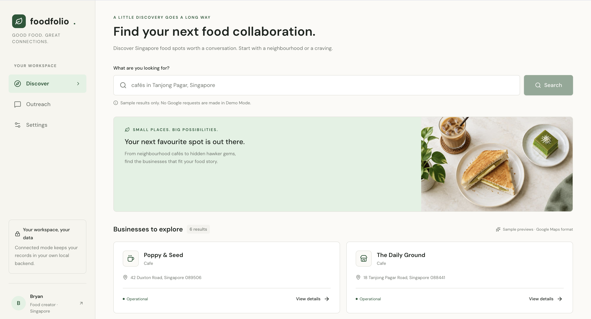

## Overview

Foodfolio is a local-first workspace for discovering Singapore food businesses and managing collaboration outreach for a food creator. It brings business discovery, public contact research, AI-assisted message drafting, outreach history and tasting planning into one interface.

The implementation separates preparation from action: Gemini produces reviewed drafts, Gmail sends explicitly approved emails, and TikTok/Instagram messages are sent manually by the user. Copying a message or opening a social profile does not mark outreach as sent.

The repository contains a Python/FastAPI backend, local PostgreSQL persistence and a React/TypeScript frontend using TanStack routing. Docker Compose defines the database, backend and frontend services. This is an independent project, not a claim that every component was authored without assistance.

The existing screenshot shows the application's Discover screen in Demo Mode. Its business cards are sample data, not evidence of live discovery, users or completed collaborations. No verified public demo URL has been supplied.

## My contribution & project context

On 11 October 2026, I confirmed that Lovable supplied the frontend design skeleton and that I completed the rest of the project. My role covered backend development, database persistence, external API integration, frontend adaptation and connection, tests and the local container setup.

My contributions include:

- Implementing the FastAPI backend, SQLAlchemy persistence and Alembic migrations, using stable restaurant identities and database constraints to handle duplicates.
- Integrating Google Places and sourced website contact extraction, keeping provider access separate from application workflows.
- Integrating Gemini as a bounded writing component, with structured output, saved factual inputs and Python-controlled message assembly.
- Implementing Gmail account connection, encrypted refresh-token storage, reviewed approval and send reservations that avoid blindly retrying uncertain outcomes.
- Adapting the Lovable frontend skeleton and connecting discovery, outreach and tasting-planning interactions through a typed API client.
- Developing backend/frontend tests and the Docker Compose local setup.

This was AI-assisted development and coaching, including agent-generated code changes, rather than a claim that every line was written unaided. Lovable's initial frontend design contribution is explicitly credited. The [project-details document](../README_PROJ_DETAILS.md) records learning discussions; ownership confirmation is not an independent assessment of mastery or runtime correctness. `portfolio.json` now marks the contribution scope as confirmed by me.

## Technical approach

### Frontend contract and local state ownership

Business operations go through a central [typed ApiClient contract](../src/lib/api/types.ts). The [connected client](../src/lib/api/client.ts) calls FastAPI, includes cookies for OAuth-related requests, surfaces backend errors and caches restaurant lookups by local ID. An [isolated demo implementation](../src/lib/api/demo.ts) supports the same contract with ephemeral data and no live API calls.

FastAPI owns persistent records and workflow decisions. Browser storage holds public connection settings rather than business data or provider secrets. The [API](../src/automate_food_places_outreach/api.py) performs request validation, delegates provider calls and uses SQLAlchemy sessions backed by Psycopg. [Compose](../compose.yaml) uses a persistent named PostgreSQL volume, loopback-bound ports and service health checks. See the [connection guide](../docs/frontend-backend-connection.md) for request traces.

This boundary makes demo behaviour testable without external services while keeping real workflow rules on the backend. The cost is maintaining two client implementations; demo behaviour alone cannot establish that connected mode works.

### Business identity and auditable contact research

The [Places integration](../src/automate_food_places_outreach/google_places.py) parses provider responses into Pydantic models. [Discovery persistence](../src/automate_food_places_outreach/services/discovery.py) uses Google Place IDs and PostgreSQL conflict handling rather than treating business names as unique. [Outreach queries](../src/automate_food_places_outreach/services/outreach.py) link restaurant identities to contacted records so discovery can exclude existing outreach.

[Website fetching](../src/automate_food_places_outreach/services/website_fetching.py) is separated from [HTML contact extraction](../src/automate_food_places_outreach/services/website_enrichment.py). The fetcher bounds response size, redirects and contact-page exploration, checks public network addresses and restricts navigation to the business website. Extracted emails and social links retain their source URLs. Email approval checks public-source evidence, but does not prove mailbox deliverability.

These choices expose provider boundaries, preserve auditability and reduce accidental requests to local/private network services. The bounded crawler deliberately gives up comprehensive coverage of JavaScript-heavy or unusual websites.

### AI as a bounded writing component

[Gemini drafting](../src/automate_food_places_outreach/services/gemini_drafting.py) makes one direct REST generation request; it does not use an agent framework. It receives a confirmed creator profile and restaurant facts, and requests a structured subject, personalised paragraph and used fact IDs. Pydantic checks the output shape, and Python adds limited content checks before assembling exact statistics, the collaboration offer and a fixed signature.

The [draft route](../src/automate_food_places_outreach/drafting_api.py) persists factual-input snapshots, model and prompt versions, output and attempt status. A unique request ID supports replay of completed drafts without another generation request. Failed attempts count towards a local rolling generation limit. The frontend requires confirmation before replacing existing edits, and generation does not approve or send a message.

The trade-off is explicit: deterministic assembly protects important fixed text, while model writing personalises a small part of the message. Structured output and fact references do not prove factual accuracy; an unsupported phrase such as “award-winning” may still pass. Human review remains part of the design. See [Gemini documentation](../docs/gemini-drafting.md).

An earlier tool-calling exercise is described in the documentation, but the current service performs direct writing. It should not be presented as an autonomous agent or a current multi-tool orchestration system.

### Approved delivery and uncertain outcomes

The [Gmail service](../src/automate_food_places_outreach/services/gmail.py) implements OAuth authorization-code exchange with state checking and PKCE, requests send-only Gmail permission plus account identity, and encrypts refresh tokens with Fernet. Refreshing access happens backend-to-Google without repeating the browser consent flow.

The [email endpoints](../src/automate_food_places_outreach/email_api.py) separate approval from delivery. The send handler checks the saved sender and approval state, locks relevant rows, enforces a rolling send limit and commits `email_sending` before calling Gmail. The complete MIME message is Base64URL-encoded for the provider API; this encoding is not encryption.

Automatic retry is deliberately avoided. Gmail may accept a message even if its response is lost, so ambiguous outcomes become `email_unknown`; a crash before the outcome commit can leave `email_sending`. This prioritises avoiding duplicate cold outreach over automatic recovery and requires manual reconciliation. It does not guarantee exactly-once external delivery, and `sent` is not proof of receipt or a reply.

## Evidence & limitations

### Implemented versus tested

Source evidence exists for Places discovery, sourced contact extraction, manual social outreach, status corrections, tasting planning, creator profiles, structured Gemini drafting and Gmail approval/delivery. Presence of those paths is not a current end-to-end runtime certification.

The repository contains tests for:

- [Restaurant CRUD](../tests/test_restaurant_crud.py) and [discovery identity handling](../tests/test_discovery.py).
- [Website fetching safeguards](../tests/test_website_fetching.py) and [contact extraction](../tests/test_website_enrichment.py).
- [Outreach lifecycle and duplicate protection](../tests/test_outreach.py).
- [Gmail OAuth, approval and send outcomes](../tests/test_gmail.py), using mocked provider responses and rollback-isolated database sessions.
- [Gemini schema/content validation and failure handling](../tests/test_gemini_drafting.py), using MockTransport and dependency overrides.
- [Frontend API safety](../src/test/api-safety.test.ts) and [outreach UI workflows](../src/test/outreach-workflow.test.tsx), including demo isolation and approval boundaries.

These tests were inspected for this case study, not executed for this publishing task. No passing-test count, performance figure, adoption metric or commercial impact is claimed. Mocked responses cannot establish live provider permissions, factual model accuracy or actual recipient delivery.

### Current limitations and source consistency

The app is local and single-user. OAuth state is stored in process memory, and local-origin checks are not a production authentication layer. Public deployment would require authentication, authorisation, HTTPS, secret-management and recovery work.

Some repository documents are stale: the main README and connection guide list AI drafting as future work, while the current drafting source implements it. This case study uses the source rather than copying those descriptions.

A further static-review concern is that the [OutreachAttempt model](../src/automate_food_places_outreach/models/outreach.py) still declares the older status constraint and non-null `sent_at`, whereas the [Gmail migration](../migrations/versions/7d1022345283_add_approved_gmail_outreach_and_sourced_.py) allows email preparation states and nullable timestamps. The email handler also uses `attempt.email`, but the inspected model files do not declare that ORM relationship. These inconsistencies need verification and correction before claiming a clean-schema, fully working email workflow. No application code was changed while preparing this portfolio.

Deterministic lead scoring, automatic contact-channel fallback, reply/bounce polling, scheduled follow-ups, a complete suppression/audit system and Apple Calendar integration are not implemented. Social DMs remain manual. WhatsApp is excluded.

## Further development

First, reconcile ORM models with applied migrations and verify the approved-email relationship on both an existing database and a clean migration setup. Run the relevant backend and frontend suites and document reproducible results before making stronger reliability claims.

Next, improve the existing workflow with explicit reconciliation for unresolved sends, sanitised provider-error categories, durable suppression and audit records. Keep external side effects separate from ordinary status editing.

Future product work could add reproducible Python lead scoring with component breakdowns, a single-channel routing policy, bounded follow-ups and Apple Calendar export after confirmed tastings. These are proposed extensions, not current features.

For applied AI, build a small evaluation set of supported and unsupported restaurant claims and compare drafts against source evidence. That would provide stronger grounding evidence than JSON shape checks alone, while preserving user approval before contact.

Personal contribution scope has been confirmed by Bryan. Before publication, still confirm the rights to publish the existing cover and any intended demo URL. Only a supplied and verified public URL should replace the current null value.
